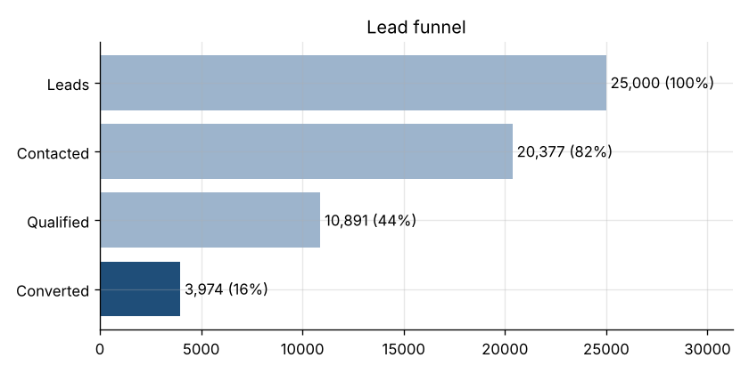
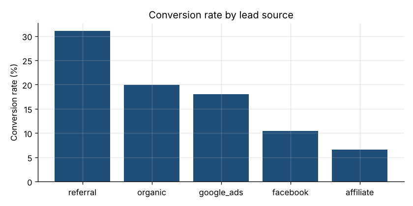
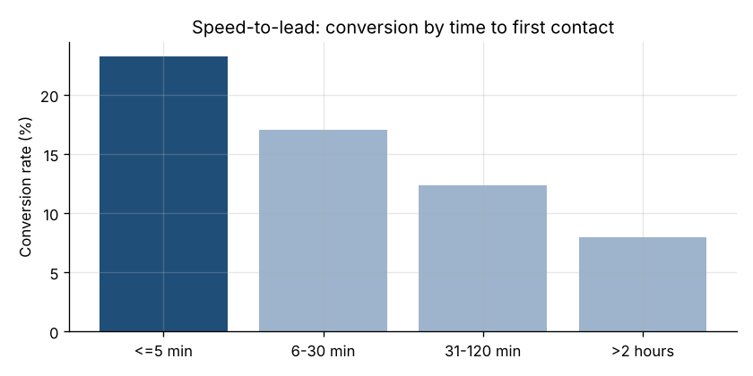
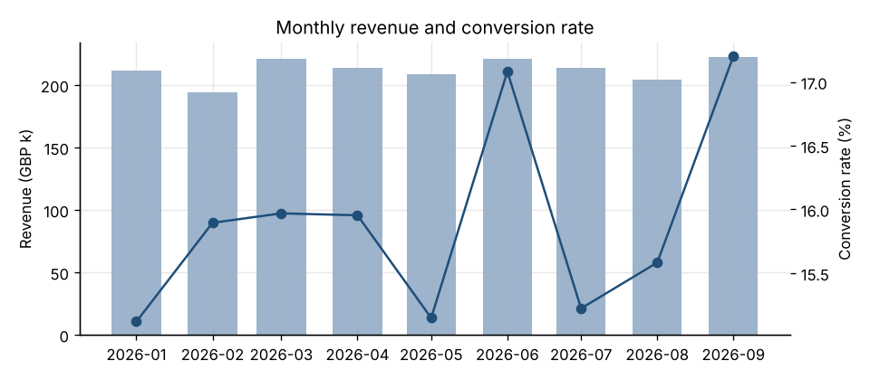
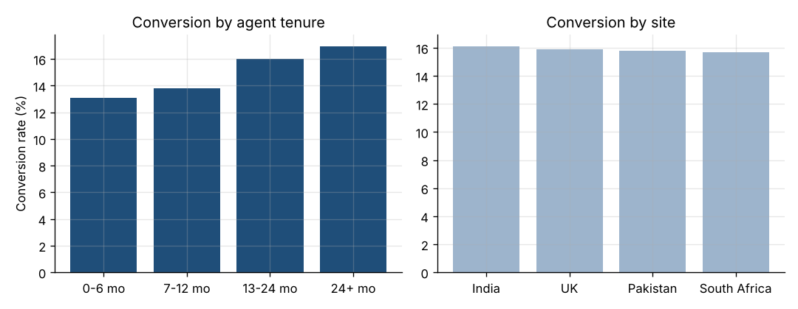

# Findings summary

_Generated by `src/analysis.py` from the synthetic dataset in `data/`._

## Data cleaning
- Raw rows: 25,150. Removed 150 duplicate lead records.
- Normalised inconsistent source labels (e.g. `FACEBOOK` to `facebook`).
- Set 60 impossible negative contact times to missing.
- Clean rows analysed: 25,000.

## Headline KPIs
| KPI | Value |
|---|---|
| Leads | 25,000 |
| Contact rate | 81.5% |
| Qualification rate | 43.6% |
| Conversion rate | 15.9% |
| Revenue | GBP 1,911,831 |
| Paid acquisition cost | GBP 224,586 |
| Return on ad spend | 8.5x |
| Median minutes to first contact | 20 |

## Key insights
1. **Speed to lead is the biggest lever.** Leads contacted within 5 minutes convert at 23.3% versus 8.0% when first contact takes over 2 hours (2.9x).
2. **Source quality varies widely.** `referral` converts at 31.1% while `affiliate` converts at 6.6%.
3. **Agent tenure matters.** Conversion rises steadily with tenure: 0-6 mo: 13.1%, 7-12 mo: 13.8%, 13-24 mo: 16.0%, 24+ mo: 17.0%.
4. **Weekends underperform.** Saturday/Sunday average 13.5% vs weekday 16.9%.

## Recommendations
- Set a 5-minute first-contact SLA with real-time alerts on uncontacted leads.
- Shift paid budget towards the highest-ROAS sources and review affiliate lead quality.
- Pair newer agents with experienced ones and route high-value campaigns to tenured agents.
- Staff weekends with experienced agents or call back weekend leads first on Monday morning.

## Source performance
| Source | Leads | Conversion | Revenue (GBP) | Cost per sale (GBP) | ROAS |
|---|---|---|---|---|---|
| referral | 2,547 | 31.1% | 385,125 | 0 | n/a (unpaid) |
| organic | 3,808 | 20.0% | 366,975 | 0 | n/a (unpaid) |
| google_ads | 7,461 | 18.1% | 649,897 | 77 | 6.2x |
| facebook | 8,684 | 10.5% | 434,870 | 72 | 6.7x |
| affiliate | 2,500 | 6.6% | 74,964 | 333 | 1.4x |

## Charts

